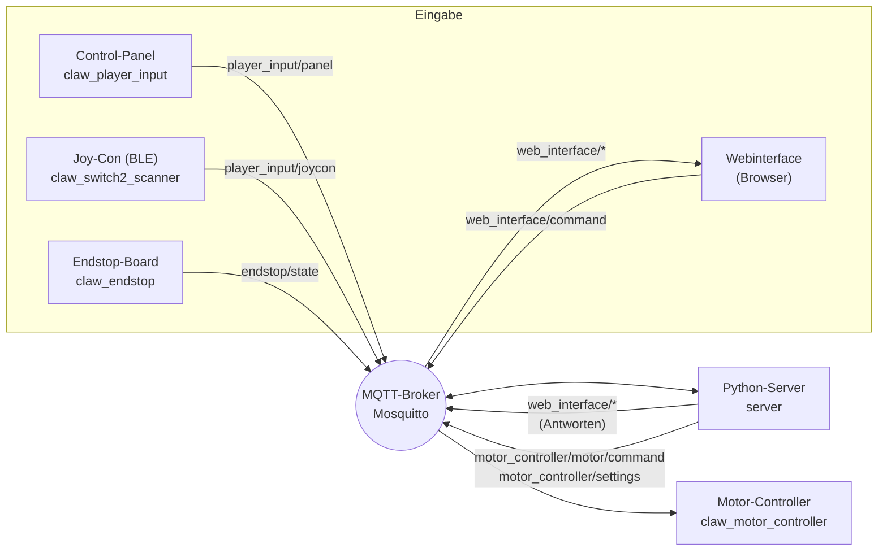
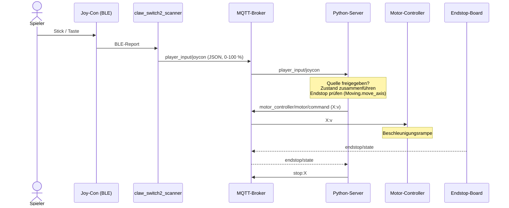

# MQTT-Architektur Clawmachine

Stand: aus dem Code abgeleitet (`python_server/clawmachine/topics.py`, `claw_machine.py`, `moving.py`,
`src_*/main.cpp`, `lib/claw_mqtt_connection`, `lib/claw_ota`, `frontend/src/app/services/mqtt.service.ts`).

Alle Topic-Namen des Servers stehen zentral in `python_server/clawmachine/topics.py` und werden dort
aus `CLAWMACHINE_TOPIC_PREFIX` (`clawmachine`) per `device_topic(<name>, ...)` bzw. `web_interface_topic(...)`
zusammengesetzt. Das Gegenstück `parse_device_name(topic, ...)` liest den Gerätenamen wieder aus einem Topic.

## 1. Teilnehmer

| Teilnehmer | Ort | MQTT-Client-ID | Rolle |
|---|---|---|---|
| Python-Server | Server-Rechner (Docker-Container `clawmachine-server`) | `server` | Zentrale Logik: wertet Eingaben aus, steuert Motoren, führt Geräteliste |
| Motor-Controller | ESP32, `src_claw_motor_controller` | `claw_motor_controller` | Führt Motorbefehle aus (X/Y/Z, Greifer) |
| Endstop-Board | ESP32, `src_claw_server` | `claw_endstop` | Meldet Endschalter-Zustand |
| Control-Panel | ESP32, `src_claw_panel_input` | `claw_player_input` | Physische Taster des Spielers |
| Switch-2-Joy-Con | ESP32, `src_claw_switch2_scanner` (BLE) | `claw_switch2_scanner` | Joy-Con-Eingabe |
| Webinterface | Browser (Angular), per WebSocket Port 9001 | `claw_web_interface_<4-stellige-ID>` | Bedienung, Geräteliste, Anzeige |
| Emulierter ESP | `python_server/emulated_esp` | `emulated_esp` | Testgerät (Uptime, `error_log`-Dummy bzw. Steuerbefehle) |
| OTA-Skript | Entwicklungsrechner, `scripts/dev/ota_update.py` | – | Baut Firmware, publiziert Download-URL auf `<name>/ota`, wartet auf `<name>/ota/status` |
| Broker | Mosquitto, Port 1883 (MQTT) / 9001 (WebSocket) | – | Vermittler, Login Pflicht (`allow_anonymous false`) |

Alle Clients melden sich mit Benutzer/Passwort aus `config.ini` (`[mqtt]`) am Broker an.
Der Python-Server merkt sich seine Subscriptions (`MQTTClient.subscribe`) und abonniert sie nach jedem
Wiederverbinden (z. B. Broker-Neustart) automatisch neu.

## 2. Datenfluss

Alle Geräte senden zusätzlich `<name>/status` und `<name>/metadata/uptime` an Server und Webinterface.

Kernprinzip: **Eingabegeräte sprechen nie direkt mit den Motoren.** Alles läuft über den Server.
Der Server ist die einzige Stelle, die auf `motor_controller/*` schreibt.
Beim Start publiziert der Server außerdem die Homing-Sequenz (`Moving.start_homing_sequence()`, aufgerufen in
`ClawMachine.__init__`), die anhand der Endstop-Meldungen die Achsen nacheinander referenziert.

Ablauf einer Spielereingabe:
1. Panel oder Joy-Con publiziert den Tastenzustand (JSON) auf `player_input/panel` bzw. `player_input/joycon`.
2. Server prüft, ob die Quelle freigegeben ist (`input_sources`), führt den Zustand mit dem letzten zusammen
   und rechnet ihn prozentual in Geschwindigkeiten um: Panel-Tasten zählen als 100 %, Joy-Con-Werte (0–100) werden direkt als Prozent genommen. Die Standard-Geschwindigkeit je Achsengruppe steht in `config.ini` (`[motor_speed]`: `xy_percent`, `z_percent`, `claw_degrees_per_second`, `minimum_percent`, `xy_accel`, `z_accel`, `claw_jog_degrees_per_second`). Eine angesteuerte Achse fährt mindestens mit `minimum_percent`, weil Schrittmotoren darunter sichtbar ruckeln.
3. Alle Fahrbefehle (Panel, Joy-Con, Webinterface, `clawmachine/claw`) laufen über `Moving.move_axis(achse, prozent)`. Dort wird auf die Standard-Geschwindigkeit der Achse skaliert und der Endstop geprüft: Negative Richtung zeigt auf den Endstop der Achse (wie beim Homing); ist er ausgelöst, sendet der Server `0` statt der Fahrt. Löst der Endstop während der Fahrt aus oder ist das Homing fertig, sendet der Server `stop:<Achse>`: Der Motor-Controller hält die Achse dann sofort an, ohne die Beschleunigungsrampe herunterzufahren. Das Anfahren (auch beim Homing) läuft weiter über die Rampe. Eingaben auf einer Achse, die gerade referenziert wird (Homing), werden ignoriert. Gesendet wird nur bei Änderung: `X:<v>`, `Y:<v>`, `Z:<v>` auf `motor_controller/motor/command`.
4. Motor-Controller setzt die Achse um.

Zeitlicher Ablauf einer Joy-Con-Eingabe:

## 3. Topic-Liste

Richtung: **→ Broker** = Publisher, **← Broker** = Subscriber. `<name>` = Client-ID des Geräts.

### 3.1 Geräte-Lebenszeichen (alle ESP32, über `ClawMqttConnection`)

| Topic | Von → An | Payload | Retained | Bemerkung |
|---|---|---|---|---|
| `clawmachine/<name>/status` | ESP → Server, Webinterface | Text `online` / `offline` | ja | `online` beim Verbinden, `offline` als Last Will (QoS 1). Webinterface sendet das gleiche für sich selbst |
| `clawmachine/<name>/metadata/uptime` | ESP → Server, Webinterface | Text, Millisekunden seit Boot (z. B. `123456`) | nein | alle 5 s |
| `clawmachine/<name>/registered` | Server → Gerät | Text `ok` | nein | einmalig, wenn der Server ein Gerät zum ersten Mal sieht (automatische Registrierung) |
| `clawmachine/<name>/error_log` | ESP → Server und Webinterface (der Server wertet nur `need-homing` aus) | JSON `{"device","topic","payload","error"}` | nein | Motor-Controller meldet einmalig nach dem Start `need-homing` (Server startet das Homing) sowie unverarbeitbare Befehle (ungültiges JSON, unbekannte Achse/Klauen-Aktion, keine Zahl). `payload` ist auf 100 Zeichen gekürzt. Der Emulator sendet jede Sekunde den Text `Emulated ESP is running.` |

Es gibt kein Anmelde-Topic: ein Gerät gilt als registriert, sobald es auf `status` oder `metadata/uptime` auftaucht.
Browser-Clients (`<name>` beginnt mit `claw_web_interface_`) werden bewusst nicht in die Geräteliste aufgenommen.

### 3.1.1 OTA-Update (`lib/claw_ota`, derzeit nur Motor-Controller)

| Topic | Von → An | Payload |
|---|---|---|
| `clawmachine/<name>/ota` | `ota_update.py` → Gerät | JSON `{"url":"http://<broker-host>:8000/firmware/<env>.bin"}` |
| `clawmachine/<name>/ota/status` | Gerät → `ota_update.py` | JSON `{"device","state","detail"}` mit `state` = `started`, `success`, `error`, `confirmed`, `rolled_back` |

Das Gerät lädt nur von `http://` und nur vom Broker-Host (`CLAW_MQTT_BROKER_HOST`). Die `.bin` liefert der
Python-Server unter `/firmware/` aus (Ordner `firmware_updates/`). Vor dem Flashen stoppt der Motor-Controller
alle Motoren. Die neue Firmware wird erst bestätigt (`confirmed`), wenn MQTT verbunden ist und beide Motor-Shields
am I2C-Bus antworten, sonst Rollback (`rolled_back`).

### 3.2 Eingabe → Server

| Topic | Von → An | Payload |
|---|---|---|
| `clawmachine/player_input/panel` | Panel-ESP → Server | JSON `{"up":0,"down":0,"left":0,"right":0,"front":0,"back":0,"claw":0}` (Tasten 0/1, `claw` = Klauen-Poti in Prozent 0–100; der Server bildet es auf den Klauenwinkel 90–160° ab und sendet `claw:<winkel>`), nur bei Änderung |
| `clawmachine/player_input/joycon` | Joy-Con-ESP → Server | JSON `{"up":0,"down":0,"left":0,"right":0,"front":0,"back":0}`, Werte 0–100 (Prozent: Tasten 100, zusätzlich `clawOpen`/`clawClose` (0/100) für die Schultertasten (L/ZL links = auf, R/ZR rechts = zu). Linker Joy-Con: Stick und Steuerkreuz = X/Y. Rechter Joy-Con: Stick senkrecht = Z. Stick = Auslenkung hinter der Totzone mit Hysterese; Änderungen unter 3 Prozentpunkten werden nicht gesendet), nur bei Änderung. Gleiche Feldnamen wie Panel (dort 0/1) ohne `claw` |
| `clawmachine/endstop/state` | Endstop-ESP → Server, Joy-Con-ESP | JSON `{"x1":0,"x2":0,"y1":0,"y2":0,"z1":0}`, `1` = ausgelöst, nur bei Änderung |
| `clawmachine/web_interface/command` | Webinterface → Server | Text `<name>:<wert>`, siehe 4 |
| `clawmachine/claw` | beliebig → Server | Text `X:<v>` / `Y:<v>` / `Z:<v>` / `claw:<aktion>`, Haupt-Steuertopic (wird vom Emulator `steering.py` genutzt) |

### 3.3 Server → Motor-Controller

| Topic | Von → An | Payload |
|---|---|---|
| `clawmachine/motor_controller/motor/command` | Server → Motor-Controller | Text `X:<v>`, `Y:<v>`, `Z:<v>` (Geschwindigkeit, ganzzahlig, negativ = Gegenrichtung, `0` = Stopp) oder `stop:<Achse>` (z. B. `stop:X`, sofortiger Stopp ohne Rampe) oder `zero:<Achse>` (aktuelle Stellung = Position 0, der Server sendet es beim Erreichen des Endstops, auch im Homing) oder `goto:<Achse>:<Schritte>:<Prozent>` (fährt mit Betrag `Prozent` zur Position und hält dort sofort an; jedes `X:`/`stop:` dieser Achse bricht die Zielfahrt ab) oder `claw:<aktion>` (`claw:open`, `claw:close`, `claw:jog_open` / `claw:jog_close` (fährt langsam, bis `claw:stop` kommt; der Server sendet das, solange die Klauen-Taste am Joy-Con gehalten wird) oder ein Winkel in Grad, z. B. `claw:120`; die Klaue begrenzt auf 90–160°). Der Motor-Controller akzeptiert zusätzlich JSON, z. B. `{"X":100,"Y":0,"Z":0,"claw":"open"}` (`"claw"` auch als Zahl, Winkel in Grad); nur enthaltene Felder werden angewendet. Der Server sendet bisher das Textformat |
| `clawmachine/motor_controller/position` | Motor-Controller → Server | JSON `{"X":1200,"Y":0,"Z":340}`: vom Motor-Controller mitgezählte Schritte je Achse im Server-Koordinatensystem (0 = Endstop, positiv = vom Endstop weg). Bei Änderung höchstens alle 200 ms, sonst alle 5 s |
| `clawmachine/motor_controller/settings` | Server → Motor-Controller | JSON mit einem oder mehreren Feldern: `{"accelerationPercentPerSecond": 50.0}` (alle Fahrmotoren), `{"xyAccelerationPercentPerSecond": 50.0}` / `{"zAccelerationPercentPerSecond": 50.0}` (getrennt für X/Y und Z) bzw. `{"xyMaxRevolutionsPerMinute": 120}` / `{"zMaxRevolutionsPerMinute": 120}` (Drehzahl, die 100 % entspricht, aus `config.ini`; der Server sendet sie beim Start und bei jeder Neuregistrierung) bzw. `{"xTravelSteps": 1200}` (auch `y`/`z`; Verfahrweg in Schritten, 0 = unbegrenzt: nach dem Homing hält der Motor-Controller die Achse selbst bei 0 und beim Verfahrweg an; bei MQTT-/WLAN-Verlust stoppt er alle Achsen) bzw. `{"clawSpeedDegreesPerSecond": 35.0}` (Klaue, konstante Geschwindigkeit ohne Rampe, Minimum 1) |

### 3.4 Server ↔ Webinterface

| Topic | Von → An | Payload |
|---|---|---|
| `clawmachine/web_interface/devices/request` | Webinterface → Server | leer (Anfrage) |
| `clawmachine/web_interface/devices` | Server → Webinterface | JSON-Array `[{"name","isOnline","uptimeMilliseconds","addedAtUnixSeconds"}]` |
| `clawmachine/web_interface/input_sources/request` | Webinterface → Server | leer (Anfrage) |
| `clawmachine/web_interface/input_sources` | Server → Webinterface | JSON `{"panel":true,"joycon":true}`, auch ungefragt nach jeder Änderung |
| `clawmachine/web_interface/input_sources/set` | Webinterface → Server | Text `<quelle>:on` oder `<quelle>:off`, Quelle = `panel` oder `joycon` |
| `clawmachine/web_interface/speed_settings/request` | Webinterface → Server | leer (Anfrage) |
| `clawmachine/web_interface/speed_settings` | Server → Webinterface | JSON `{"xyPercent":100,"zPercent":100,"clawDegreesPerSecond":35.0,"xyAccelerationPercentPerSecond":50,"zAccelerationPercentPerSecond":50}`, auch ungefragt nach jeder Änderung |
| `clawmachine/web_interface/position/request` | Webinterface → Server | leer (Anfrage) |
| `clawmachine/web_interface/position` | Server → Webinterface | JSON `{"position":{"X":0,..},"isReferenced":{"X":true,..},"gotoTargets":{"X":null,..},"travelSteps":{"X":0,..}}`, bei jeder Positionsmeldung des Motor-Controllers und auf Anfrage |
| `clawmachine/web_interface/endstop` | Server → Webinterface | durchgereichter Endstop-JSON (wie `endstop/state`) |

Das Webinterface abonniert `clawmachine/#` und füllt damit Live-Status und Geräte-Log. Die Geräteliste fragt es zusätzlich zyklisch an.

## 4. Befehle des Webinterface (`web_interface/command`)

| Payload | Wirkung des Servers |
|---|---|
| `left:
` / `right:
` | Eingabe in Prozent (-100..100, Vorzeichen = Richtung), vom Server auf die eingestellte XY-Geschwindigkeit skaliert → `motor_controller/motor/command` als `X:<v>` |
| `front:
` / `back:
` | wie oben → `Y:<v>` |
| `claw:<aktion>` | unverändert weitergereicht |
| `accel:<prozent_pro_s>` / `xy_accel:…` / `z_accel:…` | Beschleunigung in %/s: `accel` für X/Y und Z gemeinsam, die anderen getrennt. Der Server hält die Werte und sendet sie als JSON (`xyAccelerationPercentPerSecond`, `zAccelerationPercentPerSecond`) an `motor_controller/settings`, auch nach einem Neustart des Motor-Controllers |
| `home` | startet die Homing-Sequenz (X, Y, Z nacheinander) neu; ein laufendes Homing wird verworfen und alle Achsen halten an |
| `goto:<x>,<y>,<z>` | Zielfahrt in Schritten, leere Felder lassen die Achse stehen (z. B. `goto:1200,,300`). Nur nach dem Homing (`isReferenced`), nicht während des Homings und nur innerhalb 0..`*_travel_steps` aus `config.ini`; sonst wird alles abgelehnt. Geschwindigkeit: `goto_percent` |
| `goto_cancel` | bricht laufende Zielfahrten ab (Sofortstopp der betroffenen Achsen) |
| `claw_speed:<grad_pro_s>` | → `motor_controller/settings` als JSON (`clawSpeedDegreesPerSecond`) |
| `xy_speed:<prozent>` / `z_speed:<prozent>` | setzt die Standard-Geschwindigkeit der Achsen am Server (Prozent der max. Drehzahl, gilt bis zum Serverneustart); antwortet auf `web_interface/speed_settings` |

### 4.1 Position und Zielfahrten

Der Motor-Controller zählt jeden ausgeführten Schritt (`ClawStepperMotor::getStepPosition`) und meldet die
Position auf `motor_controller/position`. Es gibt keine Rückmeldung vom Motor, verlorene Schritte fallen also
nicht auf. Deshalb:

- Position 0 = Endstop. Beim Erreichen des Endstops (Homing oder Fahrt Richtung Endstop) sendet der Server
  `zero:<Achse>`, das gleicht aufgelaufene Fehler aus.
- Eine Position gilt nur, solange die Achse referenziert ist. Startet der Motor-Controller neu (Status
  `online`/`offline`), zählt er wieder ab 0, der Server setzt `isReferenced` zurück und lehnt Zielfahrten ab, bis erneut gehomt wurde.
- Eine Zielfahrt (`goto`) läuft komplett im Motor-Controller, die Regelung braucht also keine MQTT-Latenz. Sie endet
  am Ziel, per `goto_cancel` oder durch eine echte Eingabe (Panel, Joy-Con, Webinterface) auf derselben Achse. Idle-Werte (0) anderer Eingaben brechen sie nicht ab.
- Einen oberen Endstop gibt es nicht: den Verfahrweg je Achse trägt man in `config.ini` unter `[positioning]` ein
  (`x_travel_steps` usw., 0 = unbegrenzt).

## 5. Payload-Konventionen

Es gibt **keine einheitliche Struktur**, die Formate sind gewachsen. In der Praxis gelten drei Regeln:

| Art | Format | Wo |
|---|---|---|
| Zustände mit mehreren Feldern | JSON-Objekt | `player_input/*`, `endstop/state`, `input_sources`, `devices`, `motor_controller/settings` |
| Einzelne Befehle | Text `<schlüssel>:<wert>` | `motor/command`, `web_interface/command`, `input_sources/set`, `claw` |
| Einzelwerte / Flags | Reiner Text | `status` (`online`/`offline`), `metadata/uptime` (Zahl), `registered` (`ok`) |

Auffälligkeiten:
- Zwei Schreibweisen im Befehls-Bereich: `X:100` (Achsenbuchstabe groß) in `motor/command`, `left:80` (Tastenname) in `web_interface/command`. Der Server übersetzt dazwischen.
- Zwei Schreibweisen in JSON: Geräteliste in camelCase (`isOnline`), Settings ebenfalls (`accelerationPercentPerSecond`), Tastenzustände dagegen kurz und klein (`up`, `front`).
- Die Panel-Topics heißen `player_input/...`, die Client-ID des Panels aber `claw_player_input`. Topic-Segment 2 ist deshalb nicht immer die Client-ID. Gleiches gilt für `motor_controller` (Client-ID `claw_motor_controller`) und `endstop` (`claw_endstop`).

## 6. Abweichungen und tote Reste im Code

- `include/firmware_config.h`: `CLAW_DEVICE_ADDED_TOPIC "clawmachine/device/added"` ist ein Rest der alten Anmeldung und wird nicht mehr genutzt.
- `ota/status` wird vom Server nicht ausgewertet, `error_log` nur für `need-homing`; gelesen werden sie außerdem vom Webinterface (über `clawmachine/#`) bzw. `ota_update.py`.
- Die Topic-Doku in `CLAUDE.md` nennt noch `clawmachine/joycon`, `claw/uptime_*` und ein Joy-Con-Classic-Bluetooth-Setup. Das ist überholt: der Joy-Con läuft über `player_input/joycon`, Uptime über `<name>/metadata/uptime`.
- Homing startet beim Serverstart, (erst, wenn Motor-Controller und Endstop-Board online sind) und per Webinterface-Befehl `home`.
- Zwei Server mit der Client-ID `server` verdrängen sich gegenseitig vom Broker ("session taken over").

## 7. Vorschlag für eine einheitliche Struktur (noch nicht umgesetzt)

- Befehle an Geräte: `clawmachine/<name>/command`, Payload JSON `{"cmd":"move","axis":"X","speed":100}`.
- Zustände von Geräten: `clawmachine/<name>/state`, Payload JSON, retained.
- `status` und `metadata/uptime` bleiben unverändert (Last Will funktioniert nur mit einfachem Text sauber).
- Webinterface-Topics bleiben Anfrage/Antwort unter `web_interface/*`.
- Ein Feldname-Stil (camelCase) für alle JSON-Payloads.
